# LYRICA — английский по музыке

**Живая версия:** [nikitamitrasov-netizen.github.io/lyrica](https://nikitamitrasov-netizen.github.io/lyrica/)  
**Репозиторий:** [github.com/nikitamitrasov-netizen/lyrica](https://github.com/nikitamitrasov-netizen/lyrica)

Статический образовательный сайт для изучения английского через песни.
Шесть уровней CEFR, **60 песен**, **624 слова с озвучкой**, **384 вопроса**,
**300 больших заданий** и **40 карточек теории**. Без сборки, backend
и регистрации: весь прогресс хранится в браузере.

## Превью

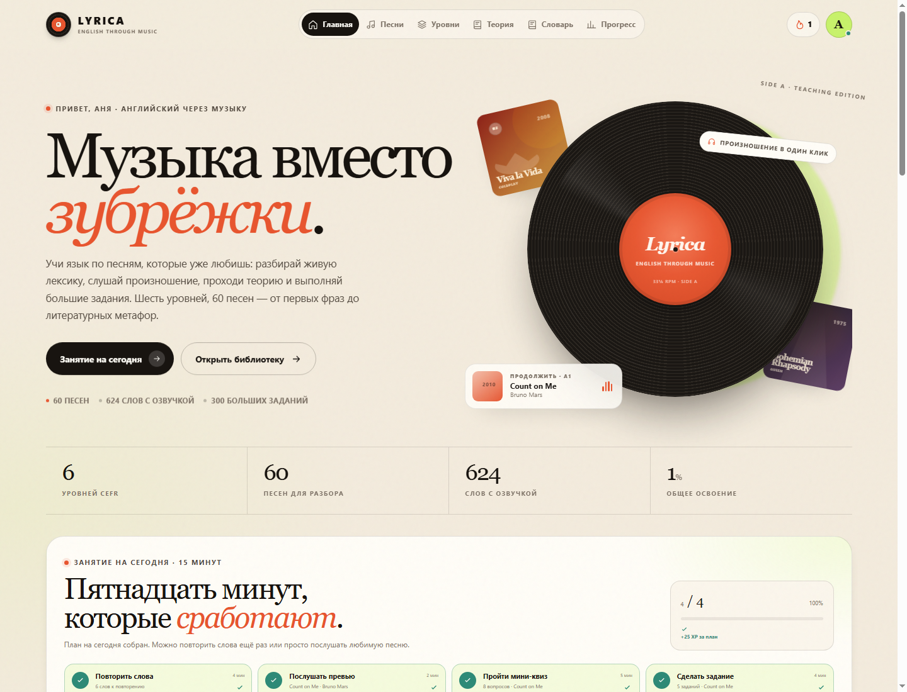

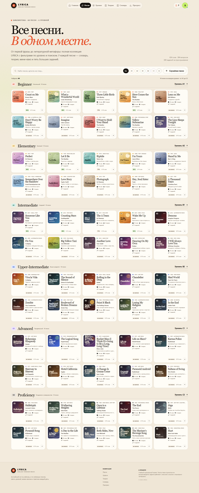


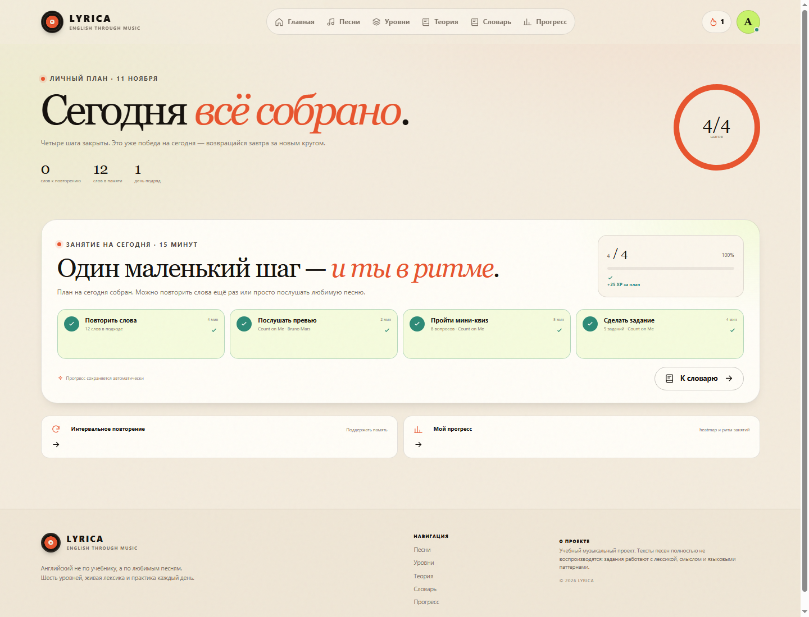

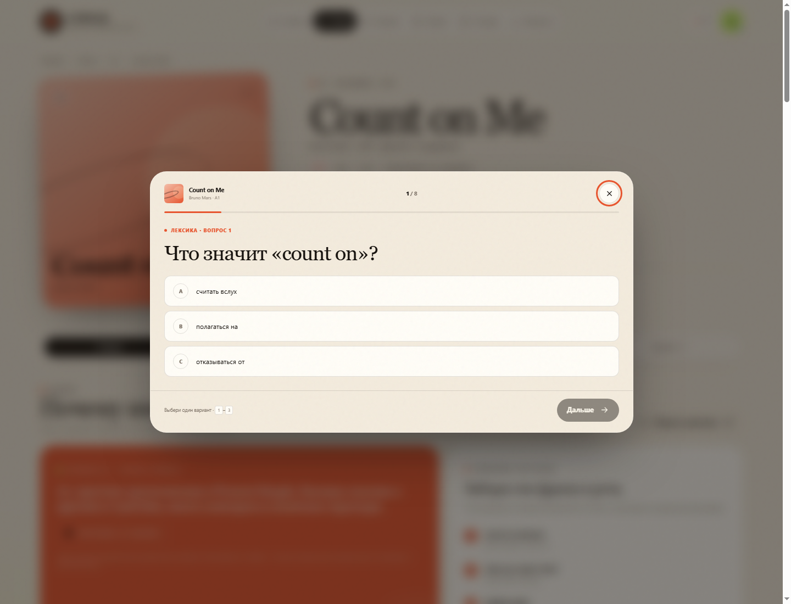

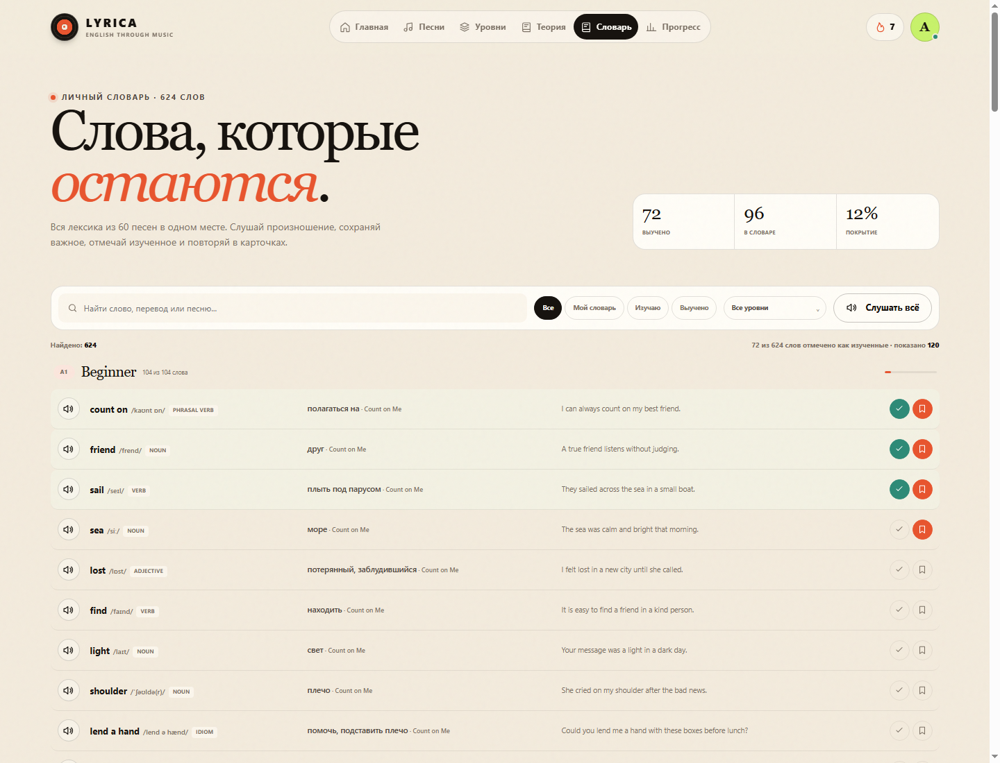

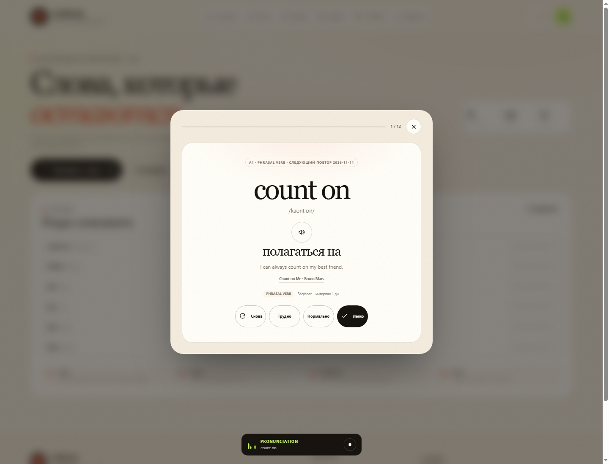

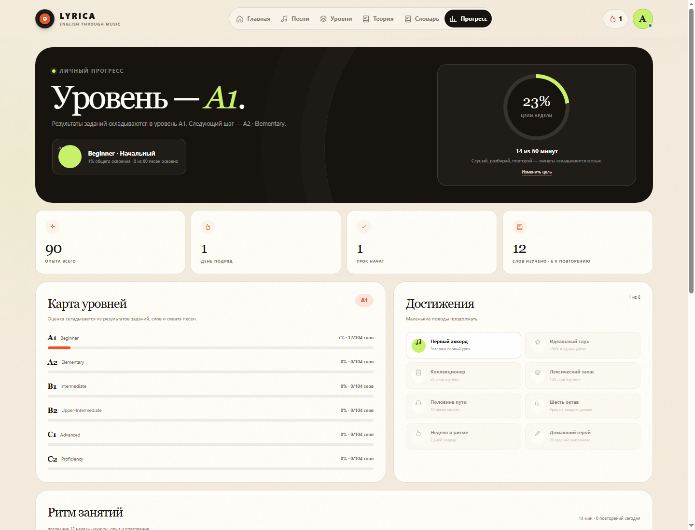

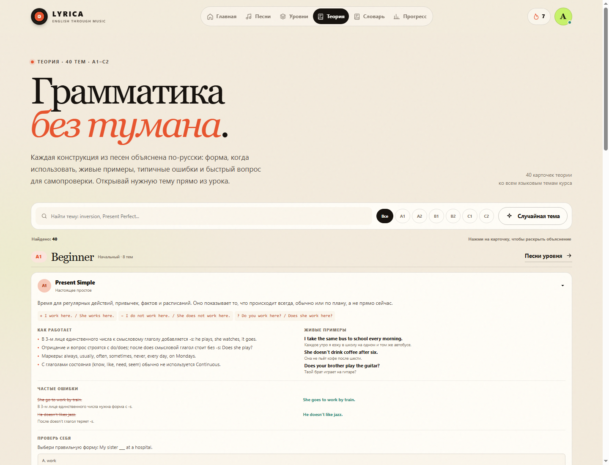

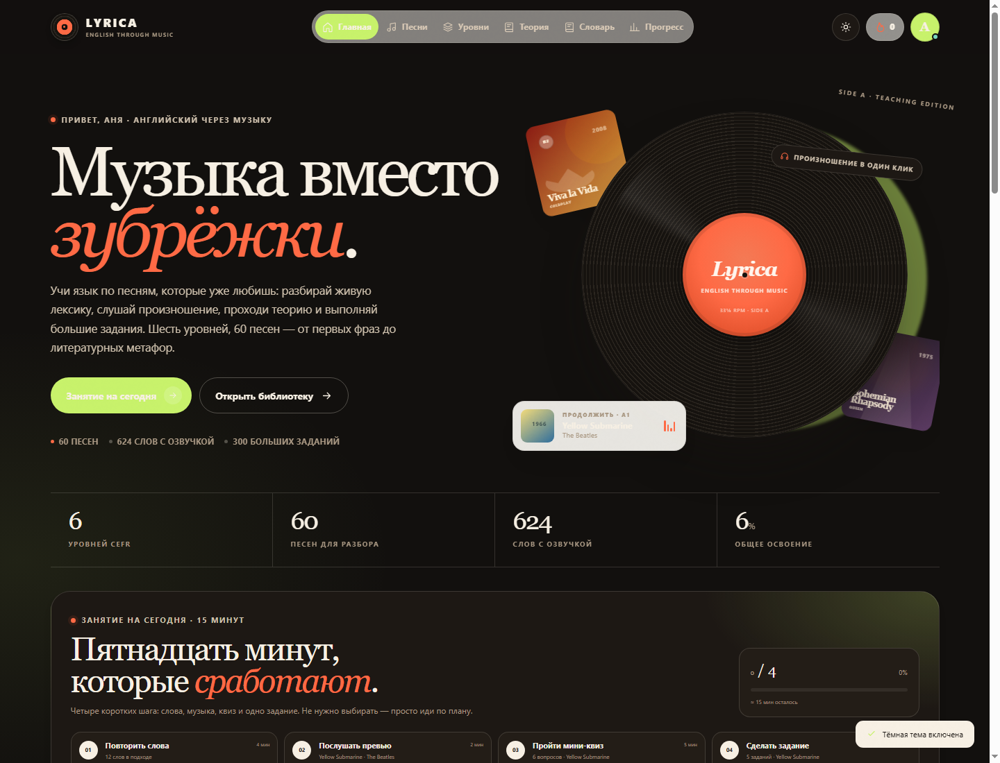

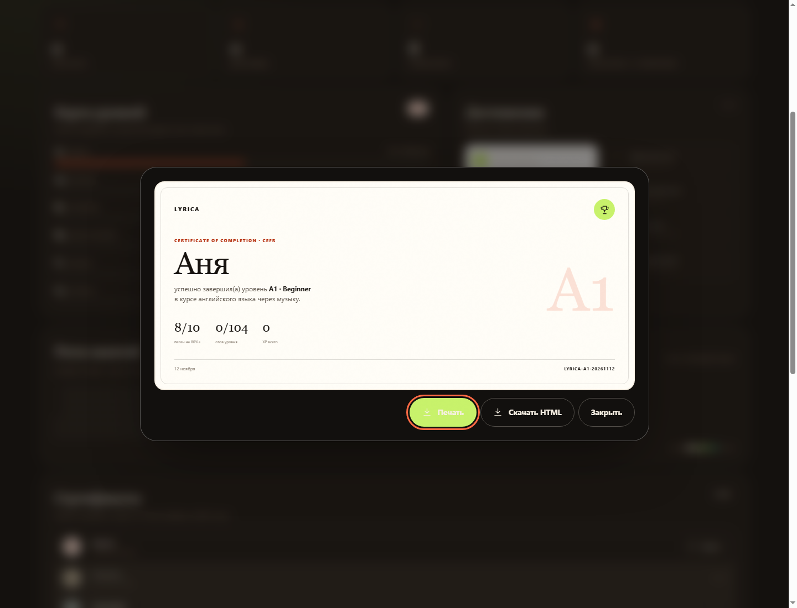

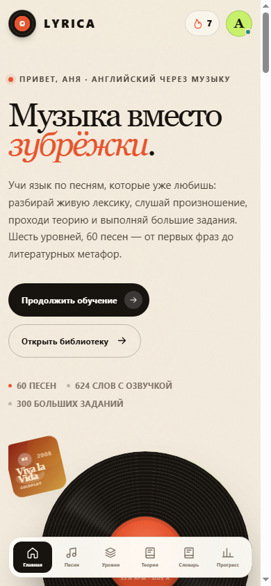

## Что уже есть

- **Встроенный плеер.** Официальные 30-секундные превью Apple Music играют прямо на странице: пауза, перемотка, повтор, скорость 0,8×, звук. Рядом — ссылка «Полная песня» на YouTube; она открывается в новой вкладке.
- **План «Сегодня 15 минут».** Четыре шага на день: повторение слов, превью песни, мини-квиз и одно задание. План сам отмечает выполненные шаги, считает минуты и даёт +25 XP за собранный круг.
- **Интервальное повторение (SRS).** Каждое слово получает свой срок следующего показа. Оценки «Снова / Трудно / Нормально / Легко» перестраивают интервал от 1 до 180 дней; очередь на сегодня собирается автоматически.
- **Listening Lab.** A/B-луп 30-секундного превью, скорость 0,6×/0,8×/1×, игра «поймай слово», запись голоса и проверка произношения через распознавание речи браузера.
- **Рабочая тетрадь.** У каждого задания есть поле ответа, автосохранение, чек-лист самопроверки, скачивание `.txt` и печатная версия worksheet.
- **Сертификаты.** За уровень с 8 из 10 песен на 80%+ открывается именной сертификат: печать или скачивание HTML.
- **Тёмная тема.** Переключатель в шапке, сохранение выбора в браузере и отдельная палитра для всех разделов.
- **PWA.** Manifest, иконки и service worker: после публикации на HTTP/HTTPS сайт устанавливается на телефон и открывается офлайн.
- **6 уровней CEFR, по 10 песен в каждом.** У уровня есть описание навыков,
  результат обучения, плейлист, теория и прогресс.
- **60 реальных песен** — от Bruno Mars и The Beatles до Radiohead, Björk
  и Nine Inch Nails.
- **624 слова** — 10–12 единиц на песню: часть речи, транскрипция, перевод
  и оригинальный пример. Каждое слово озвучивается, сохраняется в личный
  словарь и отмечается как изученное.
- **384 вопроса в мини-квизах** — лексика, контекст, аудирование, грамматика
  и смысл песни. Порог освоения — 80%, ошибки автоматически попадают в словарь.
- **300 больших заданий — по 5 на каждую песню.** В среднем 25–40 минут на
  задание. У каждого есть цель, пошаговый план, результат и самопроверка.
  Задания построены вокруг активного прослушивания: карта песни, работа с
  ключевыми строками на слух, грамматическая трансформация, пересказ через
  новую лексику и творческая задача.
- **40 карточек теории.** Present Simple, conditionals, inversion, metaphor,
  literary analysis и другие темы: форма, правила, примеры, типичные ошибки
  и быстрый вопрос для самопроверки.
- **Библиотека песен** с поиском и фильтром по уровню.
- **Биография артиста, 3 факта и 3 рекомендации** «что послушать дальше» —
  прямо на странице песни.
- **Карта прослушивания** из 5 точек: что происходит в песне по времени и на
  что обращать внимание.
- **Личный прогресс:** XP, серия дней, недельная цель, карта уровней,
  тепловая карта активности с повторениями, достижения и история попыток.
- **Умные карточки слов:** очередь SRS, четыре оценки, озвучка, пример,
  следующий срок повторения и итог подхода.
- **Профиль:** имя, цель, американский или британский акцент, скорость речи,
  экспорт JSON и сброс данных.
- **Адаптивность:** отдельная мобильная навигация, перестроение карточек,
  модальные окна и крупные зоны нажатия.


## Встроенный плеер


Плеер открывается поверх сайта и не мешает переходить между уроками. В нём
есть пауза, перемотка на 10 секунд, повтор, скорость 0,8× и выключение звука.
Превью кэшируется на 7 дней, поэтому повторный запуск почти мгновенный.

Плеер использует официальные 30-секундные превью Apple Music. Полные
треки не скачиваются и не хранятся на сайте: ссылка «Полная песня» ведёт
на YouTube в новой вкладке. Если превью недоступно, плеер покажет ошибку
и предложит повторить.

## План и повторение


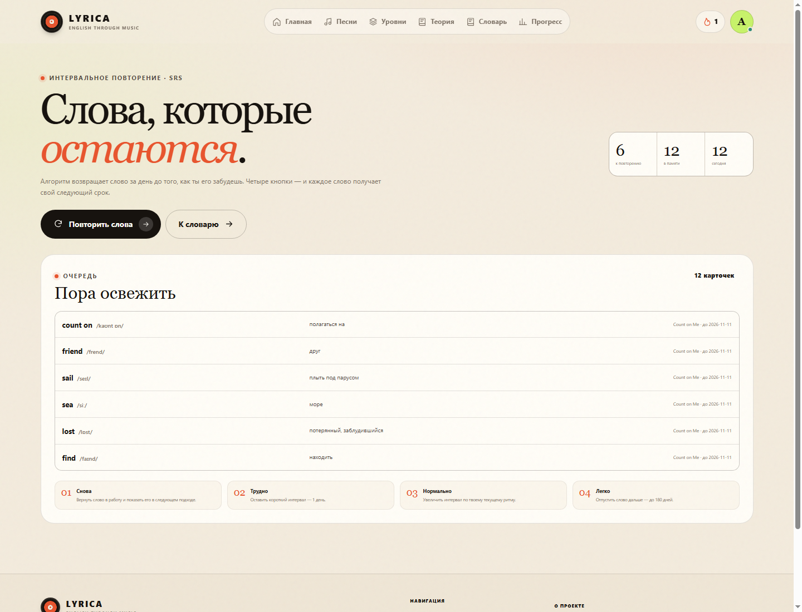


Ежедневный план собирается из четырёх шагов и не требует выбирать раздел
вручную. Шаги отмечаются автоматически: превью — после старта плеера,
квиз — после результата, задание — после галочки, слова — после подхода SRS.
За собранный план начисляется +25 XP.

SRS хранит для каждого слова интервал, ease, число повторов и дату
следующего показа. После ответа слово получает новый срок: «Снова» возвращает
его в ближайшую очередь, «Легко» может отодвинуть до 180 дней. В heatmap
прогресса видны минуты, XP и количество повторений за день.

## Listening Lab

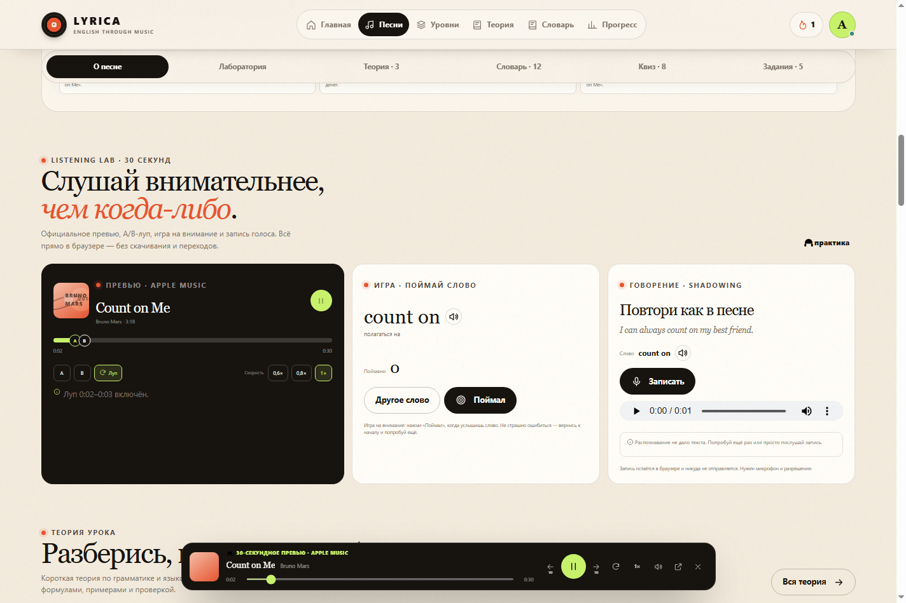

В каждом уроке есть вкладка «Лаборатория»:

- **A/B-луп** — поставь границы на 30-секундном превью и слушай один отрезок
  по кругу;
- **скорость** — 0,6×, 0,8× или 1×;
- **поймай слово** — выбери слово, слушай превью и отмечай момент, когда
  услышал его;
- **shadowing** — запиши свой голос, послушай запись и сравни с целью;
- **распознавание** — Chrome/Edge пытается распознать произнесённое слово
  через Web Speech API. Запись остаётся в браузере.

Микрофон и распознавание зависят от браузера и разрешений. Если браузер
не даёт доступ, Lab всё равно работает как плеер и тренажёр аудирования.

## Рабочая тетрадь

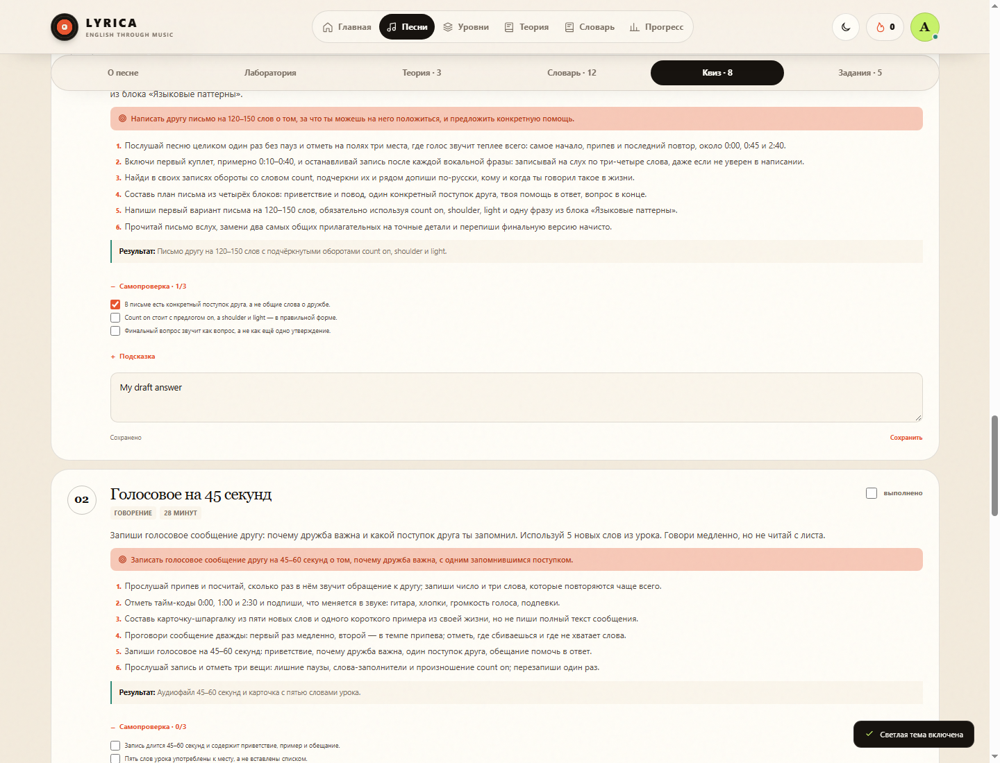

Каждое из 300 заданий превращается в страницу рабочей тетради:

- поле ответа с автосохранением через 420 мс;
- чек-лист самопроверки с прогрессом;
- статус «сохранено»;
- скачивание всей работы по песне в `.txt`;
- печать через отдельное окно с чистой вёрсткой и полями для письма.

Ответы хранятся в `localStorage` вместе с прогрессом и попадают в экспорт JSON.

## Сертификаты


Сертификат открывается, когда **8 из 10 песен уровня** пройдены на 80% и выше.
В нём есть имя, уровень, статистика и уникальный код. Можно напечатать или
скачать готовый HTML-файл.

## Тёмная тема и PWA


Тёмная тема включается кнопкой в шапке, сохраняется в настройках и работает
на всех экранах. PWA-слой добавляет `manifest.webmanifest`, иконки и
`sw.js`: после публикации на HTTP/HTTPS сайт устанавливается как приложение
и открывает оболочку офлайн.

Важно: service worker и установка PWA не работают со страницы `file://`.
Для PWA нужен обычный статический хостинг или локальный HTTP-сервер.

## Музыкальная программа

| Уровень | Песни |
|---|---|
| **A1** | Count on Me · What a Wonderful World · Three Little Birds · Here Comes the Sun · Lean on Me · Don't Worry Be Happy · Imagine · I Want to Hold Your Hand · Yellow Submarine · The Lion Sleeps Tonight |
| **A2** | Perfect · Let It Be · Riptide · I'm Yours · Stand by Me · Somewhere Over the Rainbow · Love Story · Photograph · Hey, Soul Sister · A Thousand Years |
| **B1** | Someone Like You · Counting Stars · The A Team · Wake Me Up · Demons · Fix You · Big Yellow Taxi · Another Love · Dancing On My Own · I Will Always Love You |
| **B2** | Viva la Vida · The Sound of Silence · Rolling in the Deep · Chandelier · Mad World · Zombie · Boulevard of Broken Dreams · Paint It Black · Losing My Religion · In the End |
| **C1** | Bohemian Rhapsody · The Logical Song · Rocket Man · Life on Mars? · Karma Police · Stairway to Heaven · Hotel California · A Change Is Gonna Come · Paranoid Android · Sultans of Swing |
| **C2** | Hallelujah · Wuthering Heights · Once in a Lifetime · The End · Jóga · Pyramid Song · A Day in the Life · Both Sides Now · The Mariner's Revenge Song · Hurt |

Оригиналы открываются в Apple Music по ссылкам из урока. Ссылка «Полная
песня» ведёт на YouTube в новой вкладке. Встроенный плеер использует
официальные 30-секундные превью Apple Music: полные треки не скачиваются
и не хранятся на сайте. Полные тексты песен не воспроизводятся:
задания работают с лексикой, смыслом, структурой, аудированием и языковыми
паттернами.

## Пять заданий на каждую песню

Все 60 песен устроены по одной учебной логике:

1. **Карта прослушивания** — разобрать структуру, настроение, инструменты,
   повторы и повороты истории по таймкодам.
2. **Работа со строками на слух** — пауза, запись, восстановление фраз,
   рифм и повторяющихся конструкций без распечатанного текста.
3. **Грамматическая трансформация** — переписать фразы в другой форме,
   времени или залоге, опираясь на теорию урока.
4. **Глубокая лексика** — пересказ, парафраз или перевод с 8+ новыми словами.
5. **Творческая задача** — новая строфа, аудиокомментарий, сравнительный
   анализ, запись кавера или альтернативная концовка.

У каждого задания есть цель, шаги, результат, самопроверка и подсказка.
Ответы сохраняются автоматически.

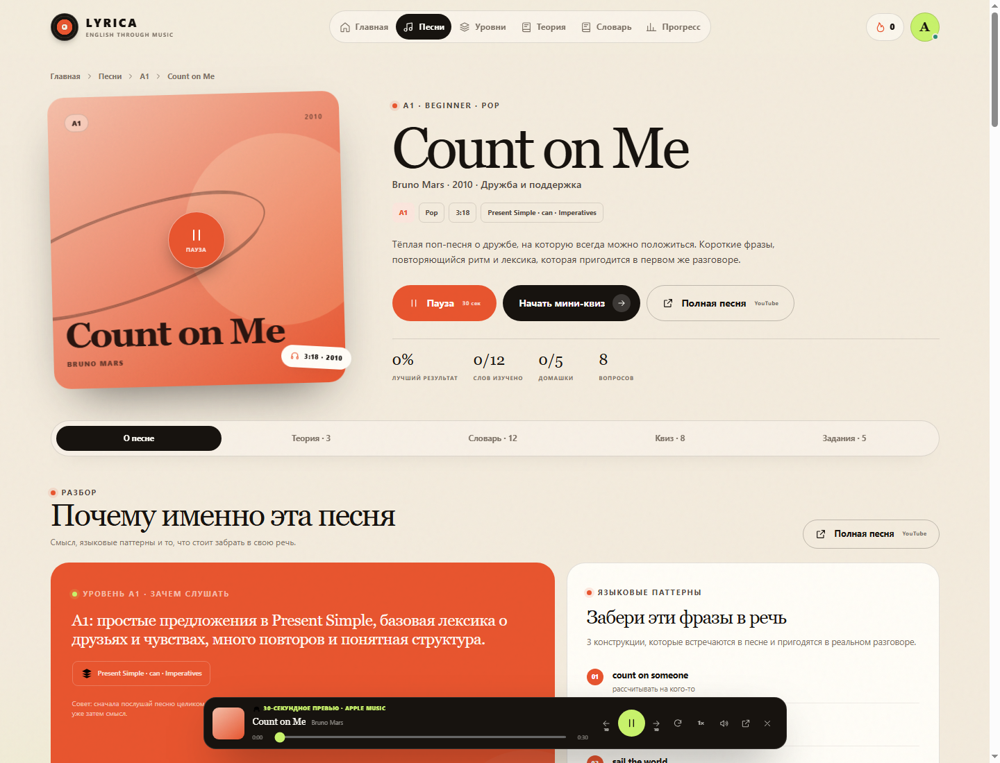

## Теория


Теория открывается из урока и из отдельного раздела. Для каждой песни указаны
2–3 релевантные темы, например:

- **A1:** Present Simple, Present Continuous, Modal Verbs, Imperatives,
  Articles and Nouns, Questions, Adjectives and Adverbs, Prepositions of Time.
- **A2:** Past Simple, Past Continuous, Present Perfect, Future Forms,
  Comparatives, Countable and Uncountable Nouns, Adverbs of Frequency.
- **B1:** Phrasal Verbs, Wish and Past Perfect, Gerund and Infinitive,
  Conditionals, Used To, Reported Speech, Question Tags, Relative Clauses.
- **B2:** Passive Voice, Narrative Tenses, Linking Words, Metaphor and Imagery,
  Personification, Abstract Nouns.
- **C1:** Word Formation, Inversion, Cleft Sentences, Participle Clauses,
  Rhetorical Questions, Register and Style.
- **C2:** Literary Analysis, Cultural References, Ellipsis and Substitution,
  Irony and Tone, Literary Vocabulary.

В каждой карточке: формула, 3–5 правил, 3 примера с переводом, 2 типичные
ошибки и вопрос для самопроверки.

## Личный прогресс


XP, серия дней, недельная цель, карта уровней, тепловая карта активности,
достижения и история занятий. Прогресс можно скачать в JSON из профиля.

## Мобильная версия

| Библиотека | Урок |
|---|---|
| 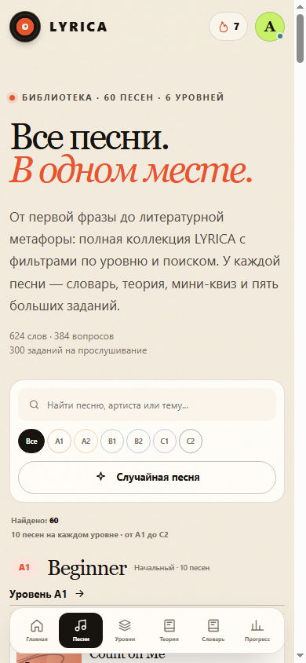 | 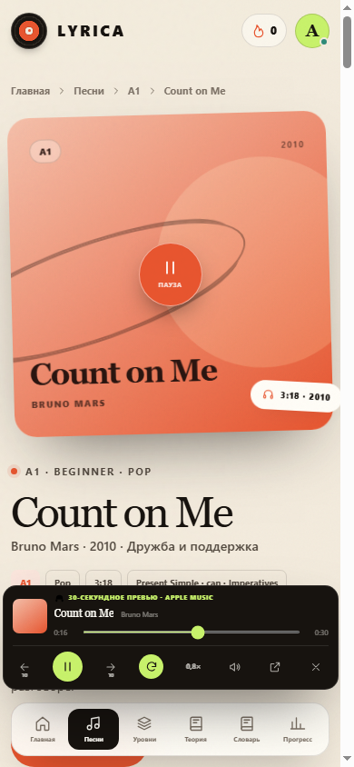 |

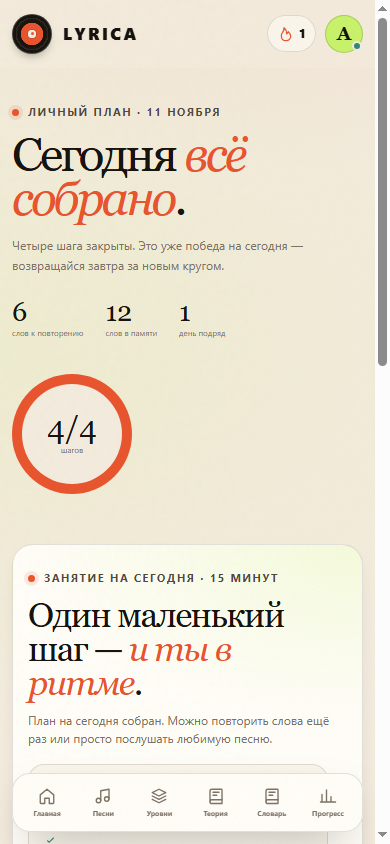

## Как запустить

Дважды щёлкни `Открыть_сайт.cmd` или открой `index.html` в Chrome/Edge.

Сайт полностью статический: сборка, установка и локальный сервер не нужны.
Контент, словарь, квизы, задания, прогресс и 30-секундные превью работают
локально. Для превью Apple Music и перехода по ссылке на полную песню нужен
интернет.

PWA-установка и офлайн-кеш требуют HTTP/HTTPS: на `file://` service worker
не регистрируется. Если нужен именно устанавливаемый вариант, опубликуй папку
на любом статическом хостинге или запусти локальный HTTP-сервер.

Озвучка слов использует Web Speech API браузера. Лучше всего работает в Chrome
и Edge; голоса и их качество зависят от системы.

## Разделы сайта

- `#/` — главная: маршрут, план на сегодня, плейлист недели, артист, теория, слово дня.
- `#/today` — «Сегодня 15 минут»: четыре шага, прогресс и быстрый переход к повторению.
- `#/review` — интервальное повторение: очередь слов, SRS-карточки и статистика.
- `#/songs` — библиотека всех 60 песен с поиском и фильтром.
- `#/levels` — шесть уровней CEFR.
- `#/level/a1` — плейлист уровня (аналогично `a2`…`c2`).
- `#/theory` — 40 тем теории; `#/theory/present-simple` — конкретная тема.
- `#/song/count-on-me` — урок: карта, артист, теория, словарь, квиз, задания и вкладка «Лаборатория».
- `#/song/count-on-me/homework` — сразу к заданиям.
- `#/vocabulary` — личный словарь с поиском, фильтрами и озвучкой.
- `#/progress` — личный прогресс, достижения и история.

## Структура проекта

```text
lyrica/
├── index.html
├── manifest.webmanifest      # PWA-манифест
├── sw.js                     # service worker для офлайна
├── Открыть_сайт.cmd           # открыть сайт в браузере
├── css/
│   ├── styles.css             # базовая дизайн-система
│   └── styles-expanded.css    # библиотека, теория, задания, плеер
├── icons/
│   ├── icon-192.png
│   ├── icon-512.png
│   └── apple-touch-icon.png
├── js/
│   ├── data.js                # уровни, базовые 12 песен, merge-логика
│   ├── content/
│   │   ├── a1.js … c2.js      # ещё 48 песен, по 8 на уровень
│   │   ├── enrich.js          # био, структура, +4 слова и +2 задания
│   │   ├── task-details.js    # подробные шаги для первых 3 заданий
│   │   ├── theory.js          # 40 карточек теории
│   │   └── youtube.js         # YouTube-ID для ссылок на полные песни
│   └── app.js                 # роутер, состояние, озвучка, квиз, прогресс
├── preview/                   # скриншоты
└── README.md
```

## Как добавить песню

Добавь объект в один из файлов `js/content/a1.js … c2.js`:

```js
{
  id: "song-id",
  title: "Song Title",
  artist: "Artist",
  year: 2024,
  genre: "Pop",
  level: "a2",
  duration: "3:30",
  theme: "Тема урока",
  cover: { bg1: "#...", bg2: "#...", ink: "#...", accent: "#...", motif: "wave" },
  description: "…",
  why: "…",
  grammar: "Past Simple · Present Perfect",
  theory: ["past-simple", "present-perfect"],
  artistBio: "…",
  facts: ["…", "…", "…"],
  listenNext: [{ title: "…", artist: "…", why: "…" }],
  structure: [{ time: "0:00", label: "Intro", focus: "…" }],
  chunks: [{ en: "…", ru: "…" }],
  vocab: [{ word: "…", pos: "…", ipa: "/.../", ru: "…", example: "…" }],
  quiz: [{ type: "choice", prompt: "…", options: ["…"], answer: 0, explain: "…" }],
  homework: [{
    title: "…", type: "Аудирование", minutes: 30, goal: "…",
    task: "…", steps: ["…"], deliverable: "…", selfCheck: ["…"], hint: "…"
  }]
}
```

Доступные мотивы обложек: `wave`, `sun`, `orbit`, `leaf`, `rain`, `stars`,
`crown`, `echo`, `stage`, `grid`, `halo`, `moor`. Неизвестные мотивы
автоматически заменяются.

Для ссылки на полную песню добавь ID официального YouTube-видео в
`js/content/youtube.js`:

```js
window.LYRICA_YOUTUBE = {
  "song-id": "dQw4w9WgXcQ"
};
```

## Публикация

Сайт опубликован через **GitHub Pages**:

- URL: https://nikitamitrasov-netizen.github.io/lyrica/
- Репозиторий: https://github.com/nikitamitrasov-netizen/lyrica
- Источник Pages: ветка `main`, папка `/`, файл `.nojekyll` уже добавлен.

Любой push в `main` автоматически пересобирает сайт за 30–60 секунд. На HTTPS
работают PWA-установка, офлайн-кеш и микрофон в Listening Lab; прогресс на
опубликованной версии хранится отдельно от локальной.

## Ограничения

- **Авторские права.** Полные тексты песен не включены. Задания предлагают
  слушать оригинал и записывать строки на слух; ссылки ведут в Apple Music.
- **Аудио.** Встроенный плеер воспроизводит официальные 30-секундные превью
  Apple Music. Ссылка «Полная песня» открывает YouTube в новой вкладке.
  Аудиофайлы не скачиваются и не хранятся на сайте. Озвучка слов и фраз —
  синтез речи браузера, не запись носителя.
- **Данные.** Прогресс привязан к браузеру и устройству. Аккаунтов и сервера
  нет; прогресс можно скачать в JSON.
- **Интернет.** Для озвучки слов не нужен. Для 30-секундных превью Apple Music
  и перехода по ссылке на YouTube нужен интернет.

## Проверка

В проекте проверены:

- 60 песен, ровно по 10 на каждом уровне;
- 624 слова, у каждой песни 10–12 слов;
- 384 вопроса, у каждой песни 6–8 вопросов;
- 300 заданий, у каждой песни ровно 5;
- 40 тем теории, все ссылки из песен разрешаются;
- библиотека, поиск и фильтры;
- полный проход квиза и сохранение результата;
- SRS-подход: оценки, интервалы, следующая дата, завершение и +15 XP;
- все четыре шага ежедневного плана, автопометки и +25 XP;
- heatmap с минутами, XP и повторениями;
- Listening Lab: A/B-луп, скорости, «поймай слово» и запись голоса;
- микрофонный сценарий проверен с тестовым аудиоустройством;
- рабочая тетрадь: 5 полей ответа, 15 чек-листов, автосохранение;
- сертификат: условие 8/10, модальное окно, печать и скачивание HTML;
- тёмная тема: переключение, сохранение и контраст на всех экранах;
- PWA: manifest, service worker, офлайн-загрузка оболочки;
- озвучка, карточки, автосохранение заданий;
- профиль и настройки;
- мобильные экраны 320–768 px без горизонтального скролла;
- отсутствие JavaScript-ошибок в консоли.

---

Учебный проект. Сделан как статический сайт без сборки и внешних зависимостей.
